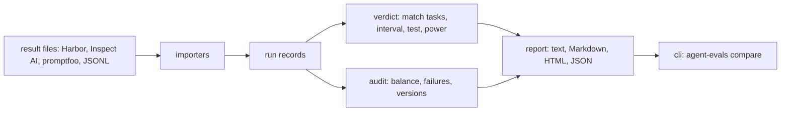

# Architecture

agent-evals turns run records into one verdict on a change. A run record is the result of one run of one arm on one task.

## Packages

| Package                   | Purpose                                                      | May depend on                               |
| ------------------------- | ------------------------------------------------------------ | ------------------------------------------- |
| `@agent-evals/statistics` | Numeric methods on plain numbers.                            | nothing                                     |
| `@agent-evals/records`    | The run record schema.                                       | nothing                                     |
| `@agent-evals/importers`  | Reads the result files of other harnesses.                   | `records`                                   |
| `@agent-evals/audit`      | Checks if the records support a fair comparison.             | `records`                                   |
| `@agent-evals/verdict`    | The comparison of two arms, the verdict, and the power plan. | `statistics`, `records`                     |
| `@agent-evals/report`     | Builds and renders the report.                               | `statistics`, `records`, `audit`, `verdict` |
| `@agent-evals/cli`        | The `agent-evals` command.                                   | `records`, `importers`, `verdict`, `report` |

`tooling/src/boundaries/packages.ts` holds this graph, and `bun run lint` checks every import against it.

## Rules that keep a result true

- **The task is the unit.** Repeats of one task are not independent evidence, so each task gives one difference.
- **A failed run has no score.** An infrastructure failure never becomes a 0.
- **The same records give the same report.** Each method takes its seed as input.
